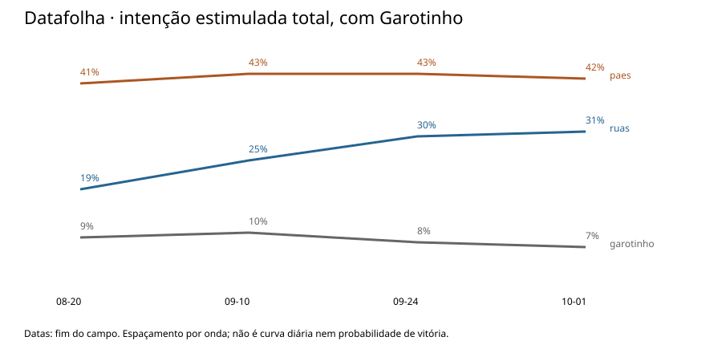
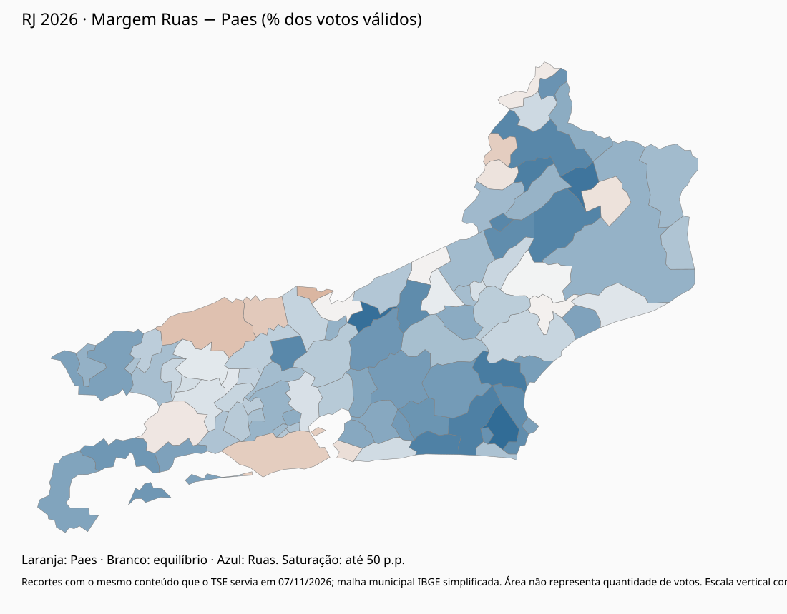
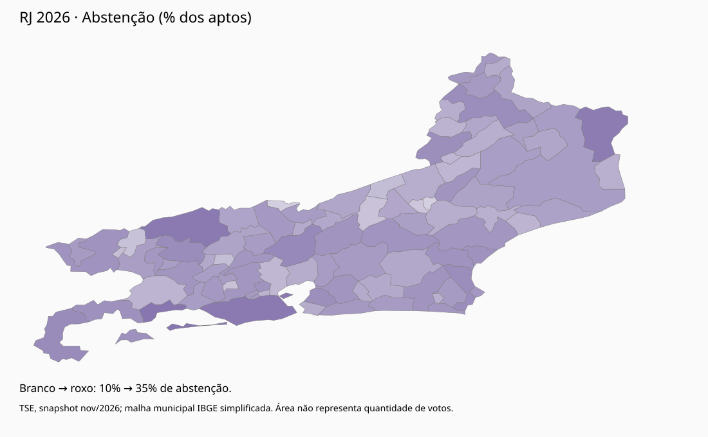

# Análise detalhada

Recorte documental: 7/11/2026, com a correção da auditoria independente dessa data. A pergunta é por que a expectativa inicial sobre Paes não se realizou, distinguindo o resultado observado dos mecanismos ainda não identificados. [Resumo](README.md), [fontes](research/FONTES.md), [lacunas](research/LACUNAS.md) e [tabelas](results/TABELAS.md). Siglas e termos de método estão no [glossário](#11-glossário).

Os recortes eleitorais deste repositório têm, segundo a auditoria de 7/11/2026, o mesmo conteúdo que o canal do TSE servia naquele dia. Os ZIPs nacionais não foram baixados de novo nesta correção. O ZIP de seções foi obtido outra vez do CDN do TSE e é byte-idêntico ao manifesto e ao digest registrado para o asset `dados-v1`; o asset privado em si não foi baixado. Isso não é autenticidade histórica nem veracidade da apuração. A margem de 564.215 votos é a da publicação oficial, não uma verificação independente da urna.

## 1. O acontecimento que precisa ser explicado

A votação ocorreu em **4/10/2026**. O segundo turno nacional estava previsto para **25/10**, mas a eleição fluminense de governador terminou no primeiro turno após retotalização. Em 8/10, o TSE rejeitou a homologação da desistência, deu parcial provimento para afastar a inelegibilidade da alínea “l” e manteve o indeferimento por falta de plenitude dos direitos políticos e de filiação partidária; por 5 a 2, determinou a anulação e a retotalização. Em 10/10 houve retotalização; em 15/10 o TRE-RJ proclamou Ruas eleito. A chapa eleita é Douglas Ruas/Fernanda Louback. A ADPF 1362 e a ação relatada em novembro impedem descrever o resultado como judicialmente incontroverso. Não foi obtida prova de trânsito em julgado, nem o acórdão de 8/10. [Fontes F1–F4 e F19](research/FONTES.md).

Os oito candidatos com votos válidos estão na tabela reproduzida, com número e partido. A nona candidatura relevante é **Anthony William Garotinho Matheus de Oliveira (Republicanos, 10)**, ausente das linhas de votos válidos do snapshot estadual. Não confundir com Rosinha, Wladimir ou Clarissa, nem atribuir posição uniforme ao conjunto da família.

| Conta | Antes da exclusão de Anthony | Após a retotalização |
|---|---:|---:|
| Votos de Ruas | 4.271.199 | 4.271.199 |
| Votos de Paes | 3.706.984 | 3.706.984 |
| Denominador válido | 8.669.038 | 8.394.627 |
| Ruas / denominador | 49,2696% | 50,8802% |
| Margem Ruas menos Paes | 564.215 | 564.215 |

O “antes” é reconstrução contábil: os válidos do snapshot mais os 274.411 votos de Anthony. Não foi lido numa totalização oficial anterior. A exclusão reduz o limiar de maioria pela metade desse volume. Ruas passa a ficar 73.885,5 votos acima da metade dos válidos. Isso explica o encerramento no primeiro turno, **não explica de onde vieram seus 4,27 milhões de votos**. A vantagem sobre Paes já existia antes. Não se pode afirmar quem venceria um segundo turno que não aconteceu.

## 2. Pesquisas: aproximação comprovada, instante da ultrapassagem desconhecido

As séries abaixo não foram desenhadas como uma curva única. Campo sobreposto, pergunta e método diferentes impedem ordenar institutos como se fossem a mesma série temporal. O grau da fonte está em [pesquisas.csv](data/pesquisas.csv). Registros eleitorais não foram conferidos no PesqEle.

### Datafolha, total estimulado com Anthony

| Campo | Paes | Ruas | Anthony | Branco/nulo | Indecisos |
|---|---:|---:|---:|---:|---:|
| 18–20/8 | 41 | 19 | 9 | 16 | 4 |
| 8–10/9 | 43 | 25 | 10 | 9 | 3 |
| 22–24/9 | 43 | 30 | 8 | 6 | 4 |
| 28/9–1/10 | 42 | 31 | 7 | 8 | 4 |
| 2–3/10 | 41 | 34 | 6 | 6 | 5 |

A série até 1/10 vem do relatório original de 2/10, página 10, não 11. A onda de 2–3/10 (RJ-01334/2026, n=2.002, margem de 2 p.p.) está no PDF v2 de 5/10, em `evidencias/2026-11-07/pdfs/datafolha-final-0310.pdf`. O g1 de 3/10 às 18h18 já trazia os mesmos números; a página do instituto é de 4/10 às 16h32. A ficha da onda de 28/9–1/10 começa em 28/9 e a narrativa em 29/9. As fichas completas das duas primeiras ondas não foram obtidas. A de 22–24/9 (n=1.204, 35 municípios, RJ-02205/2026) foi recuperada em republicação, não no PDF de 2/10. As datas de divulgação 11/9 e 24/9 têm apoio secundário na Folha e em O Globo; 21/8 não tem fonte e saiu do CSV.

No total, a margem cai de 22 para 7 pontos. Ruas vai de 19% a 34%; Paes termina como começou, em 41%, com oscilação no meio. A série **não descreve uma perda equivalente de Paes para Ruas**. Nos válidos com Anthony, a última onda é **46 / 38 / 7** (Paes +8), não os 47 / 35 / 8 da onda anterior (Paes +12). O crescimento pode reunir antigos indecisos, terceiros, declarantes de voto inválido e mudanças nos dois sentidos. Sem painel, as entradas e saídas são desconhecidas.

### Outras séries, cada uma no seu método

| Instituto | O que entrou | Ruas no total | Últimos válidos com Anthony | Grau |
|---|---|---|---|---|
| Paraná | Agosto, sem dias informados; 5–7/9; 20–22/9; 29/9–1/10 | 15,5 → 20,3 → 26,7 → 30,1 | 47,9 / 34,4 / 9,4 (Paes +13,5), RJ-07095/2026 | Original em `evidencias/2026-11-07/pdfs/parana-RJ_Out26-original.pdf` |
| Atlas | Rótulos 31 ago e 20 set, sem ficha; campo verificado 22–27/9; campo verificado 27/9–2/10 | 27,6 → 32,4 → 35,7 → 38,0, na ordem do gráfico | 48,6 / 39,8 / 6,4 (Paes +8,8), RJ-02601/2026 | Os dois primeiros pontos não têm data de campo. A última onda é só republicação do Poder360 |
| Quaest | Cerca de 8/9; 19–22/9; 25–28/9; 2–3/10 | 18 → 23 → 25 → 28, nos totais | 49 / 40 / 6 (Paes +9) | Secundária. Os válidos são modelo de eleitor provável. Totais da última onda: 35 / 28 / 4, indecisos 15, branco/nulo/não vai votar 13 |
| Real Time Big Data | 14/9, RJ-03902; 25–29/9, RJ-08712 | 25 e depois 31 | Válidos não obtidos | Secundária. O PDF de RJ-08712 não foi conferido visualmente. BR-05193 é pesquisa presidencial e não entra |

Na véspera, Paes tinha de +8 a +13,5 nos válidos com Anthony: Datafolha +8, Atlas +8,8, Quaest +9 no modelo e Paraná +13,5. Nenhuma onda deste corpus mostra Ruas à frente. O último campo com data na ficha termina em 3/10 no Datafolha e na Quaest, e em 2/10 na Atlas. A ultrapassagem não é datável. Conciliar as pesquisas com a urna exigiria uma mudança de margem de cerca de 14 p.p. depois do campo, um erro comum aos institutos, ou uma combinação dos dois. Os dados não separam essas hipóteses. Não se data a virada pelo debate de 29/9, pela decisão de 2/10 nem pelo dia da votação.

A pergunta da Atlas muda, entre 22–27/9 e 27/9–2/10, de “Se esses fossem os candidatos...” para “Em quem você vai votar...”. Os campos se sobrepõem em 27/9. O gráfico da p.10 rotula “28 set” um ponto cuja ficha, na p.5 do PDF de setembro, diz coleta de 22/09/2026 a 27/09/2026, e rotula “03 Out” o ponto cuja ficha da republicação diz coleta até 02/10/2026. “31 ago” e “20 set” aparecem só como rótulos desse eixo. Nenhum dos dois PDFs traz ficha de campo para esses pontos. A série 27,6 → 32,4 → 35,7 → 38,0 é a ordem em que a Atlas desenhou os pontos, não uma taxa por dia. A margem é de 2 p.p. no PDF e de 3 p.p. no texto do Estadão; essa divergência não foi resolvida e não é tratada como fato. O crescimento de Ruas nessa ordem permanece visível. A figura espaça as ondas por igual.

Não foram adotados os 48,1/39,0 atribuídos a agregadores. A auditoria não localizou referência rastreável. Esses números ficam fora da série. Também há reportagem sobre Veritá com 42,3/41,9 válidos, campo 13–18/9, mas registros divergentes (RJ-01332 e RJ-05322). O original não foi recuperado. É um alerta contra a unanimidade dos institutos, não uma observação certificada.

### Erro de margem, denominador e erro líquido

Com Anthony no denominador, a margem oficial Ruas−Paes era 6,51 p.p. A diferença entre a margem da pesquisa e essa margem da urna é **14,51 p.p.** no Datafolha de 2–3/10 e **18,51 p.p.** no de 28/9–1/10. A onda de 1/10 deixou de ser a medida final do instituto. O confronto usa só o cenário com Anthony contra os válidos com Anthony (8.669.038). As linhas “sem Garotinho” são cédula hipotética e não entram na diferença. [Teste reproduzido](results/pesquisas-confronto.json).

A retotalização desloca a margem em **0,21 p.p.** e o nível de Ruas em **1,61 p.p.** (de 49,27% para 50,88%). O 0,21 p.p. é 1,15% do erro de margem da onda de 1/10 e 1,47% do erro da onda de 2–3/10, ambos medidos contra os válidos com Anthony. O 1,61 p.p., contra os válidos com Anthony, é 11,3% do erro de nível de Ruas na onda de 1/10 e 14,3% na de 2–3/10. Contra o percentual proclamado, o mesmo 1,61 p.p. é cerca de 10% do desvio da onda de 1/10 (50,88 − 35). O denominador explica o limiar de 50%, não o desencontro. Brancos mais nulos digitados são 11,95% do comparecimento, perto dos 11% de branco/nulo mais indecisos no Datafolha de 2–3/10. Essa proximidade não identifica as mesmas pessoas ou preferências: indecisos podem votar validamente, e declarantes de candidato podem faltar ou anular. A renormalização uniforme dos mesmos numeradores não inverte a liderança; isso não exclui seleção diferencial dos votos válidos nem comparecimento diferencial.

No mesmo denominador, a véspera subestima Ruas (cerca de −9 a −15 p.p.) e superestima Paes (cerca de +3 a +6). Anthony aparece com 6% a 9,4% nas últimas ondas e com **3,17%** na urna. O complemento de Paes, Ruas e Anthony, quando a página permite somá-lo, tem erro de cerca de +0,2 a +5,2. Na Atlas de 3/10 a barra chamada Outros é 1,1% no total e 1,2% nos válidos; 5,0 e 5,2 são a soma dessa barra com Busnello e Siri. São saldos líquidos, não transferências. Antes de 2/10: Datafolha 8% e Paraná 9,4% para Anthony. Campo que atravessa 2/10: Atlas 6,4%. Campo iniciado em 2/10: Datafolha 7% e Quaest 6%. A hora da decisão de 2/10 não foi obtida, então não se sabe quanto desse campo é anterior a ela.

Um teste territorial condicional usa a intenção do Datafolha por “natureza do município” e, sem verificação, trata a região metropolitana do instituto como a RM analítica de 22 municípios. O peso dessa RM nos válidos da amostra foi lido pela auditoria como 74,6% e 75,3%, perto dos 74,24% do snapshot. Reponderar só por esse corte deixa a margem em 12,17 p.p. na onda de 1/10 e em 8,04 p.p. na de 2–3/10. Dentro de cada agregado, na onda final, a pesquisa tem RM 50/35/6 e interior 35/47/8; a urna tem 45,6/46,9/2,5 e 34,6/56,2/5,0. Sob a premissa, a proporção RM/interior não explica o erro agregado. Não exclui geografia intrarregional, comparecimento diferencial, não resposta nem seleção. A definição de RM do instituto não foi obtida. É cenário, não estimativa.

Não é legítimo converter 46% de intenção ou uma margem amostral de 95% em “95% de chance de vencer”. Uma previsão exigiria modelo de comparecimento, erro não amostral, correlação entre institutos, mudanças até a votação e validação histórica. Este estudo não construiu tal modelo. Expectativa jornalística de favoritismo, intenção medida, reconhecimento do nome e chance de vitória são grandezas distintas.

A rejeição de Paes no Datafolha foi de 26% em agosto e de 26% na onda de 28/9–1/10; a de Ruas, de 19% a 29%. A frase vale só até essa onda: a de 2–3/10 não publicou rejeição. Nas ondas intermediárias do mesmo PDF, Paes passou por 28% e 25%, e Ruas por 23% e 26%. Na Paraná, a rejeição de Paes foi 25,3 → 23,1 → 23,8 → 24,4 e a de Ruas 12,6 → 13,5 → 18,8 → 19,9. A estabilidade da rejeição de Paes se mantém; o “19 → 29 até a última onda” não. Medidas indiretas, que não são conhecimento pessoal: a Atlas de 22–27/9, na p.23, dá a Ruas imagem 39% positiva, 51% negativa e 10% “não sei”; a espontânea do Datafolha, no gráfico do PDF v2, foi lida pela auditoria como 8 → 13 → 20 → 19 → 22. Este repositório não reabriu esse gráfico. As bases dos gráficos não foram identificadas como brutas ou ponderadas; não se usa daí uma direção da ponderação.

## 3. Ruas: base anterior, expansão e limites da explicação partidária

A votação oficial de 2022 foi **175.977 para deputado estadual**, com **149.576 em São Gonçalo (85,0%)**. A ficha da Alerj documenta sua trajetória; a ligação familiar com o prefeito Capitão Nelson é pública. A votação é evidência direta de inserção anterior, mais forte que a impressão de desconhecimento. Não é prova de retenção das mesmas pessoas quatro anos depois.

A candidatura recebeu aval de Flávio Bolsonaro, Castro e Altineu Côrtes na articulação partidária relatada em fevereiro. O cargo de secretário de Cidades e a presidência da Alerj oferecem canais de projeção e contato. São mecanismos plausíveis de viabilização; ocupar cargo não demonstra uso ilícito da máquina nem votos entregues. [Fontes F9–F11](research/FONTES.md).

O resultado de São Gonçalo, onde Ruas obteve 61,45% dos válidos e margem de 114.731, é consistente com essa base. Mas São Gonçalo responde por apenas uma parte da vantagem: **retirado o município da conta, Ruas ainda teria margem estadual de 449.484 votos**. Essa subtração é uma decomposição territorial, não o resultado de uma eleição hipotética sem a cidade.

Flávio Bolsonaro obteve no RJ **4.966.844 votos presidenciais no primeiro turno**, 695.645 acima de Ruas. Em votos absolutos, Ruas ultrapassou Flávio em apenas três municípios: São Gonçalo, Cambuci e Tanguá. Essa conta é compatível com um campo amplo e um acréscimo local, e impede igualar automaticamente os dois eleitorados. Os cargos têm quantidades distintas de válidos (8.394.627 no governo após a retotalização e 9.369.700 na presidência). Não se lê a diferença como 695.645 pessoas que abandonaram Ruas.

A outra base, percentual dos válidos de cada cargo, responde outra pergunta e também não identifica voto cruzado. Nela, Ruas supera Flávio em **62 municípios** (35 se Anthony entra no denominador de Ruas). Fora da capital, Ruas tem 57,21% e Flávio 56,03%. Na capital, Ruas tem 40,79% e Flávio 47,88%. Paes supera Lula em percentual dos válidos fora da capital (38,30% contra 36,77%) e em 62 municípios, embora fique 192.203 votos abaixo de Lula nessa mesma área. [As duas contas](results/testes-territoriais.json).

O Datafolha de 2–3/10 observou conhecimento correto do número em **57% dos 1.769 entrevistados que citaram alguma opção de voto na pergunta estimulada para governador**, não da amostra inteira de 2.002 pessoas; **75%** entre declarantes de Ruas e **52%** entre declarantes de Paes. Entre os de Paes, 44% não sabiam e 4% citaram número incorreto. Os 67% e 44% são da onda de 28/9–1/10, não da última. “Não sabe” não é voto perdido. A ordem de votação na urna põe governador antes de presidente. Isso distingue familiaridade com a pessoa de capacidade declarada de identificar a opção. Não estima o efeito de santinhos ou propaganda.

Há um cruzamento de intenção, não de voto realizado. O g1 de 25/9, sobre o Datafolha de 22–24/9 (RJ-02205/2026 e BR-05762/2026), diz: entre eleitores de Paes, 64% Lula e 20% Flávio; de Ruas, 86% Flávio e 5% Lula; de Anthony, 47% Flávio e 34% Lula. A Folha de 26/9 traz a condicional inversa: entre eleitores de Flávio, Ruas 37% → 56% → 63% e Paes 26% → 27% → 21%. A matriz original e as bases não foram obtidas. O teste de consistência da auditoria não fecha: a interseção Ruas e Flávio dá 25,2–26,4% pela rota do governador e 27,2–28,3% pela rota do presidente, e só fecha no limite no cenário sem Anthony. O cenário e a base da tabulação não estão identificados. O uso aqui é qualitativo: alinhamento declarado, com voto cruzado possível. Não se invertem as condicionais, não se multiplicam pelos votos da urna e não se infere direção causal. A divergência entre as duas rotas permanece aberta.

## 4. Paes: força real na capital, alcance estadual insuficiente

Paes venceu na capital com **53,50%**, 1.730.683 votos e margem de 410.961. Ruas teve 40,79%. Fora da capital, Paes ficou em **38,30%**, Ruas em **57,21%**. A capital concentrou 38,54% dos válidos estaduais: vencer ali não bastava. A derrota não deve ser narrada como desaparecimento total da popularidade carioca.

Em 2024, Paes havia recebido **1.861.856 votos e 60,47%** para prefeito, segundo notícia do TSE. O recorte de 2024 não está nos insumos preservados e não foi recalculado aqui. Em 2026, na mesma cidade, a diferença para esses números documentais é de 131.173 votos e 6,97 pontos percentuais. Cargo, adversários, alianças, participação e composição do eleitorado mudaram: não são 131.173 desertores identificados. Sua vantagem na capital se manteve, mas Ruas venceu em **9 das 49 zonas municipais**. [Zonas](results/zonas.csv).

Paes conquistou apoios fora da sua legenda e procurou prefeitos do interior. A aliança com Jane Reis e o grupo de Washington Reis oferecia uma ponte para a Baixada: o [próprio MDB anunciou o apoio em 19/2](https://www.mdb.org.br/mdb-e-psd-oficializam-alianca-para-o-governo-do-rio-com-chapa-paes-jane-reis/). Washington Reis também foi relatado, em 22/2, apoiando Flávio à Presidência e pedindo votos para Castro ao Senado, e em 19/9 pedindo votos para Paes. São alianças cruzadas, não um bloco único. Mesmo assim, na partição de 13 municípios da Baixada, Ruas somou vantagem de 309.109 votos; em Duque de Caxias, 30.129. Isso limita a tese de que endossos garantiam resultado local. Não prova que o apoio não ajudou Paes: faltaria o resultado contrafactual sem esse apoio.

## 5. Geografia: margens e volume, não somente vencedores

Veja a [tabela de todas as regiões](results/TABELAS.md). Ruas e Paes estão em percentual dos válidos; a abstenção, em percentual dos aptos. A partição é **analítica e explicitamente reproduzida em `analyze.py`**. Capital, Baixada e Leste são separados; Região dos Lagos é apresentada junto das Baixadas Litorâneas (10 municípios); Centro-Sul foi acrescentado para cobrir o estado inteiro. A região Serrana inclui Petrópolis. Não se apresenta isso como uma classificação oficial única do IBGE.

Em uma segunda agregação sobreposta, a Região Metropolitana contém 22 municípios (Capital + Baixada + Leste + Petrópolis). **Essa linha não deve ser somada à partição anterior.** Malha e identificação dos 92 municípios vêm do IBGE; correspondência por nome normalizado é unívoca e auditada, gravada em `results/`, não entre os insumos. O mapa usa geometria simplificada, com escala vertical corrigida por cos(22°). Área não representa votos. Não se reconstroem limites de zonas ou seções.

- **Metropolitana:** Ruas +82.243; fora da capital metropolitana, +493.204. O restante do estado contribuiu +481.972. Portanto, “foi o interior” omite metade do déficit de Paes fora da capital.
- **Baixada:** maior contribuição regional positiva para Ruas, +309.109. Nova Iguaçu e Belford Roxo tiveram margens maiores que Duque de Caxias.
- **Leste:** +161.567 para Ruas; São Gonçalo e Itaboraí contrastam com Niterói, onde Paes abriu 20.976. Não existe um bloco leste uniforme.
- **Lagos/Baixadas Litorâneas:** Ruas 66,13%, +174.921; contribuição maior que a do Norte, embora o Norte tenha centralidade na história de Garotinho.
- **Norte e Noroeste:** margens +79.030 e +44.084. Campos teve Ruas +46.438; Conceição de Macabu e Cardoso Moreira favoreceram Paes, assim como municípios do Noroeste.
- **Serrana, Costa Verde, Médio Paraíba e Centro-Sul:** +88.692, +44.123, +55.807 e +17.843. Valença favoreceu Paes; nenhum desses agregados substitui a tabela municipal.

Os dez municípios com maiores margens pró-Ruas somam **502.396 votos de vantagem**, 51,5% do saldo fora da capital. Há concentração importante e uma contribuição extensa dos demais. Ruas venceu 79 municípios, mas a contagem de cidades, sozinha, não mede a vitória: a capital vencida por Paes pesa mais que dezenas de municípios pequenos.

## 6. Anthony, Wladimir, Rosinha, Clarissa e a decisão judicial

A notícia do TSE de 8/10, não o acórdão, descreve três decisões distintas. O Plenário rejeitou a homologação da desistência do recurso. No mérito, deu parcial provimento para afastar a inelegibilidade da alínea “l” da Lei Complementar 64/1990, pela Lei Complementar 219/2025. Manteve o indeferimento por ausência da plenitude dos direitos políticos e da filiação partidária (Constituição, art. 14, § 3º, II e V). Por 5 a 2, anulou os votos e mandou retotalizar. O inteiro teor e a certidão de trânsito não foram obtidos. A descrição para aqui.

Em 3/10 Anthony rejeitou apoio a Paes e considerou muito improvável apoiar Ruas, segundo a CNN. Uma fala de 4/10 no mesmo sentido circula na cronologia anterior deste estudo sem URL preservada; não é tratada aqui como fato verificado. Wladimir, em discurso após a votação, disse ter apoiado Anthony no primeiro turno e passou a apoiar Ruas. A notícia foi publicada em 5/10. A filiação de Wladimir ao PL não prova apoio anterior a Ruas.

A CBN de 19/8 descreve Rosinha Garotinho em reuniões com empresários e lideranças do Norte e do Noroeste, no programa “Rosinha pelo interior”, como coordenação regional da campanha de Anthony. Não há lista de participantes nem votos atribuíveis. Clarissa, segundo a mesma reportagem, atuava nos bastidores e era cotada, por integrantes da campanha, para uma secretaria num eventual governo do pai. Isso não certifica endosso a Ruas. Ausência de transferência mensurada não prova ausência de influência.

O Datafolha perguntava por um segundo turno hipotético: entre apoiadores de Anthony, 43% diziam Paes e 41% Ruas. Isso enfraquece a suposição de destino único, mas não mede transferência real, tem base de subgrupo pequena e foi anterior ao resultado. Não se multiplicaram esses percentuais pelos 274.411 votos das urnas.

O arquivo por seção identifica nominalmente Anthony, número 10, com 274.411 votos. Eles reconciliam com os nulos técnicos em todas as 183 unidades município-zona; Campos concentra 43.421 (15,82% da votação de Anthony), e o Norte soma 56.952 (20,75%). Essa concentração documenta sua base territorial, não seu destino posterior. [Auditoria por seção](results/secoes-resumo.json).

A base contém 37.675 seções principais: Ruas supera Paes em 24.416, Paes supera Ruas em 12.998, com 261 empates. O voto nulo digitado aparece agregado no código 96 (675.292). Este arquivo não isola a alegação jornalística de 204.309 confirmações do 13. Essa conta, do g1 de 6/10, não foi certificada: não há RDV nos insumos, e 204.309 ≤ 675.292 (30,3%) é só compatibilidade aritmética. Mesmo um RDV mostraria a digitação, não a intenção nem o pareamento entre cargos.

## 7. Redes, campanha e mensagens: o que está documentado

A matriz de [apoios e acontecimentos](research/CRONOLOGIA.md) distingue data do evento, publicação, tipo de relação e força da fonte. Não foi produzido um índice de “máquina” a partir da legenda de prefeitos. Há registro de avanço de Paes entre gestores e de rupturas da aliança PL/PP; isso contraria uma versão de máquina estadual inteiramente unificada. A sucessão que teria levado Ricardo Couto ao governo interino segue sem fonte preservada neste corpus; não se chama todo ato do Executivo de ação de campanha de Ruas.

Nomes que o corpus permite distinguir, sem transformar declaração em entrega de votos:

| Pessoa | Relação registrada | Limite |
|---|---|---|
| Flávio Bolsonaro, Cláudio Castro e Altineu Côrtes | Articulação do PL por Ruas, relatada em fevereiro | Não prova votos entregues |
| Capitão Nelson | Pai e prefeito de São Gonçalo; campanha do filho relatada em fonte local | Parentesco e relato não medem efeito |
| Silas Malafaia | Em 20/2, apoio alternativo a Ruas ou a Felipe Curi, não exclusivo; apresentação em templo relatada em 21/2 | Outro relato situa o ato dois dias depois de 20/2. Não representa todos os evangélicos |
| Washington Reis | Chapa de Paes em 19/2 e pedido de votos em 19/9; em 22/2, Flávio à Presidência e Castro ao Senado | Aliança cruzada. Presença de correligionários no ato não é endosso individual de cada um |
| Rosinha Garotinho | Coordenação regional de Anthony no Norte e Noroeste, CBN 19/8 | Sem lista de participantes |
| Clarissa Garotinho | Bastidores e cotação para secretaria, mesma reportagem | Não é endosso a Ruas |

A base de vereadores citada em reportagens de São Gonçalo não certifica endosso estadual. O inventário não é exaustivo. [Lacunas](research/LACUNAS.md).

As sabatinas de setembro abordaram segurança, educação, orçamento e corrupção. A checagem da Lupa identifica falas e problemas factuais de ambos; não mede audiência efetiva, persuasão ou votos. A trajetória policial de Ruas torna a segurança um atributo eleitoral plausível; a gestão municipal de Paes torna serviços e capacidade administrativa atributos plausíveis. Nenhum desses vínculos estima o efeito de propostas.

A religião aparece em entrevistas individuais do Datafolha, não apenas no mapa: Paes tinha 48% entre católicos e 29% entre evangélicos; Ruas, 29% e 40%, respectivamente. São intenções declaradas, com margens de subgrupo maiores, não prova de obediência a pastores. O Globo de 1/10 descreve publicidade impulsionada dos dois lados: Paes como “amigo das igrejas” e Ruas com imagens em cultos e “valores cristãos”. A reportagem também traz um recorte Quaest entre evangélicos (Paes 25%, Ruas 33%) e um total estadual de 36/23, que não é a onda final de 2–3/10. Não há métrica de exposição nem efeito medido. Não se elege religião, vídeo ou debate como causa decisiva.

Quatro peças não são intercambiáveis. A autoria e a distribuição estão só alegadas; as duas campanhas se acusam.

- **Santinho de 4/10:** o g1 publicou às 17h12 foto de um santinho com “GOVERNADOR / EDUARDO PAES / JANE REIS / 22”. O número de Paes é 55; o 22 é de Ruas. A reportagem atribui a fiscais do TRE a localização em Nova Iguaçu. Não há auto, nota original do TRE, quantidade nem custódia.
- **“Minha Colinha”:** dois modelos numa cópia da inicial, com governador 22 e presidente 22. Não se une esta peça ao santinho anterior nem se atribui a mesma tiragem.
- **“Rio Escolhe”:** o texto lido na cópia da inicial diz “Lula é 13” e “Bolsonaro é 22”. Não diz literalmente “Paes governador 13”. O 13 presidencial é o número de Lula; o 13 no governo seria nulo. A inicial alega 100 mil mais 500 mil mais 500 mil unidades. Tiragem alegada, não autenticada.
- **Folheto “Evangélico, de que lado você está?”:** peça religiosa distinta. A alegação de 100 mil unidades e a de multa diária de R$ 100 mil, esta última divergente de relatos de R$ 10 mil, não foram resolvidas.

O mecanismo possível do 22, se a peça induzisse voto válido em Ruas, é diferente do mecanismo do 13, que produziria nulo. Nenhum fator foi demonstrado decisivo. Faltam auto, exemplares originais, nota fiscal conferida, laudo, exposição e compreensão.

Há propostas concretas documentadas: em [entrevista à CNN](https://www.cnnbrasil.com.br/eleicoes/cnn-entrevista-eduardo-paes-candidato-ao-governo-do-rj-assista/), Paes defendeu unificar a segurança e recuperar o serviço ferroviário; Ruas apresentou segurança, transporte e saúde como prioridades na [entrevista de 17/8 à Record](https://record.r7.com/balanco-geral-rj/video/no-balanco-geral-rj-douglas-ruas-detalha-plano-de-governo-assista-a-entrevista-na-integra-17082026/). Na agenda de 7/9, [O Dia registrou](https://odia.ig.com.br/rio-de-janeiro/2026/09/7299647-candidatos-falam-em-propostas-para-educacao-e-bem-estar-animal.html) Ruas defendendo ampliação de escolas cívico-militares e Paes prometendo hospitais veterinários regionais. Isso comprova mensagens oferecidas, não sua recepção. O projeto não atribui a esses temas uma quantidade de votos.

## 8. Participação: denominadores e saldos

Foram **12.842.517 aptos**, **9.845.867 comparecimentos**, **2.996.650 abstenções (23,33%)**, **501.537 brancos** e **949.703 nulos totais**, incluindo **274.411 nulos técnicos**. Brancos e nulos são, respectivamente, 5,09% e 9,65% do comparecimento. Somam-se válidos + brancos + nulos = comparecimento, em cada unidade município-zona. Não somar os votos de Anthony novamente aos nulos totais.

A abstenção foi 26,16% na capital e 21,57% fora dela, sempre sobre os aptos. Isso é compatível com oportunidades distintas de mobilização, mas não prova que ausentes preferiam Paes nem que o diferencial causou sua derrota. Aumentar artificialmente o comparecimento da capital supondo preferências constantes produziria um cenário, não uma estimativa. Este relatório não o apresenta como resultado observado.

Não há variação entre turnos de governador a calcular. O segundo turno presidencial teve outro conjunto de escolhas; usá-lo como segundo turno estadual inventaria um evento. O detalhe de participação do cargo presidencial (aptos, comparecimento, brancos e nulos) não está nos insumos. Mesmo em comparações históricas, saldos líquidos não identificam antigos ausentes que voltaram, antigos votantes que faltaram ou mudanças de domicílio.

## 9. História e autonomia dos cargos

O PL já dispunha de grande votação: Castro recebeu 4.930.288 votos para governador em 2022, contra 4.271.199 de Ruas em 2026. O saldo de −659.089 **não é uma transferência identificada**; candidatos, coligações, conjuntura, eleitores e denominadores são diferentes. Demonstra, contudo, que a vitória de Ruas não exige imaginar um campo estadual criado do zero.

Paes teve 3.706.984 votos estaduais, muito acima dos 2.300.980 de Freixo em 2022; a comparação tampouco identifica a mesma coalizão ou eleitores. No primeiro turno presidencial de 2026, Lula teve 3.693.021 no RJ: a proximidade estadual com Paes oculta diferenças locais. Na capital, Paes superou Lula em 206.166 votos; fora dela, ficou 192.203 abaixo. Compensações agregadas não significam voto casado. A seção 3 mostra a mesma comparação em percentual dos válidos.

Em 2018, a comparação com 2026 precisa do turno. No segundo turno, Paes venceu na capital, com 51,69%, e perdeu a disputa estadual para Witzel. No primeiro turno, Witzel venceu na capital, com 39,03% contra 24,01% de Paes. As duas leituras vêm de veículos que reproduzem o TSE (UOL, 28/10/2018, e Gazeta do Povo). Os microdados de 2018 não foram abertos. Em 2024, o sucesso municipal de Paes, dado documental sem recorte preservado, coexistiu com o campo presidencial da direita. Esses antecedentes impedem tratar identidade partidária como destino imutável de cada pessoa.

Os 183 códigos de município-zona são os mesmos em 2022 e em 2026, sem código exclusivo de um ano. Código igual não prova o mesmo território: seções podem migrar entre zonas. Sem cadastro de seções e locais, a estabilidade territorial não é verificável. Por isso não houve painel de zonas. A correspondência municipal do IBGE atual também não certifica todas as fronteiras históricas. Não há regressão ecológica convertida em comportamento individual.

## 10. O que a evidência separa e o que deixa aberto

Dá para sustentar, em separado:

1. **Inserção.** Ruas não partiu de zero: votação de 2022, concentração em São Gonçalo, trajetória administrativa e rede familiar.
2. **Viabilização e associação.** Apoios nacionais registrados e alinhamento declarado com Flávio nas intenções de setembro. A comparação presidencial é compatível com as duas bases da seção 3 e não identifica o eleitor.
3. **Geografia do resultado.** A vantagem de Paes na capital (+410.961) não cobriu o saldo de Ruas no restante (+975.176).
4. **Regra jurídica.** A anulação reduziu o denominador e encerrou a disputa no primeiro turno no resultado proclamado. Nenhum voto foi transferido.

Não dá para repartir os votos de Ruas entre notoriedade, partido, líderes, religião, rejeição e mensagens. O [quadro de hipóteses](research/HIPOTESES.md) distingue três situações: a garantia de vitória estadual pela popularidade carioca é refutada pelo resultado; um disparo da rejeição a Paes não é sustentado pelas ondas disponíveis; contribuição, exclusividade e decisividade de reconhecimento, religião, debate, abstenção ou erro de número não foram identificadas. A ausência de identificação não demonstra ausência de efeito nem exclui um efeito decisivo. Decisivo não significa causa única. Uma hipótese aditiva precisaria de previsão que as outras não fazem: conhecimento antes do apoio, mudança depois de exposição com a identidade anterior controlada, rejeitantes estáveis, contatos locais ligados ao comparecimento, ou erro de conversão com intenção anterior e registro do que foi digitado. Esse desenho não está no corpus.

Mudança tardia, seleção, não resposta, ponderação e comparecimento continuam abertos. Para separá-los faltam painel, microdados, pesos e auditoria de não resposta. [Lista do que foi buscado e não obtido](research/LACUNAS.md).

**Resposta direta:** Paes perdeu apesar de liderar as últimas ondas porque a vantagem na capital foi menor que o déficit no resto do estado. O desencontro com as pesquisas permanece, menor no Datafolha quando se usa a onda de 2–3/10, e o denominador explica só uma fração pequena dele. Ruas ampliou uma base preexistente, com associação política documentada e sem decomposição do efeito de cada apoio. Anthony Garotinho teve papel jurídico no encerramento em primeiro turno; transferência de sua rede ou de seus eleitores para Ruas não foi demonstrada.

## 11. Glossário

- **ADPF.** Ação de descumprimento de preceito fundamental, ação constitucional de controle. Aqui, a ADPF 1362, do PSD, pedindo segundo turno. Não se encontrou decisão de mérito.
- **PPT.** Probabilidade proporcional ao tamanho. No relatório da Paraná, é o método de seleção de municípios e localidades. Não equivale ao recrutamento digital.
- **RDR.** Atlas Random Digital Recruitment, o recrutamento digital aleatório descrito no PDF da Atlas arquivado neste repositório.
- **Pós-estratificação.** Reponderação da amostra para aproximá-la de totais conhecidos da população. A Atlas a descreve assim. Não é o mesmo procedimento que o PPT domiciliar.
- **Válidos com Anthony.** Votos nominais dos candidatos que permaneceram válidos mais os 274.411 votos depois anulados. É a base usada no confronto com as pesquisas que incluíam Anthony.
- **Nulo técnico e nulo de urna.** O nulo técnico, neste snapshot, é o voto de Anthony, código 10. O nulo de urna, código 96, agrega o que foi digitado como nulo. O boletim de urna agrupa brancos e nulos por cargo. O registro digital do voto guarda o que foi digitado, sem identificar o eleitor e sem associar o voto de um cargo ao de outro.
- **Modelo de eleitor provável.** Procedimento da Quaest, segundo o veículo contratante, para chegar aos válidos 49/40/6. Não é o denominador das outras pesquisas.
