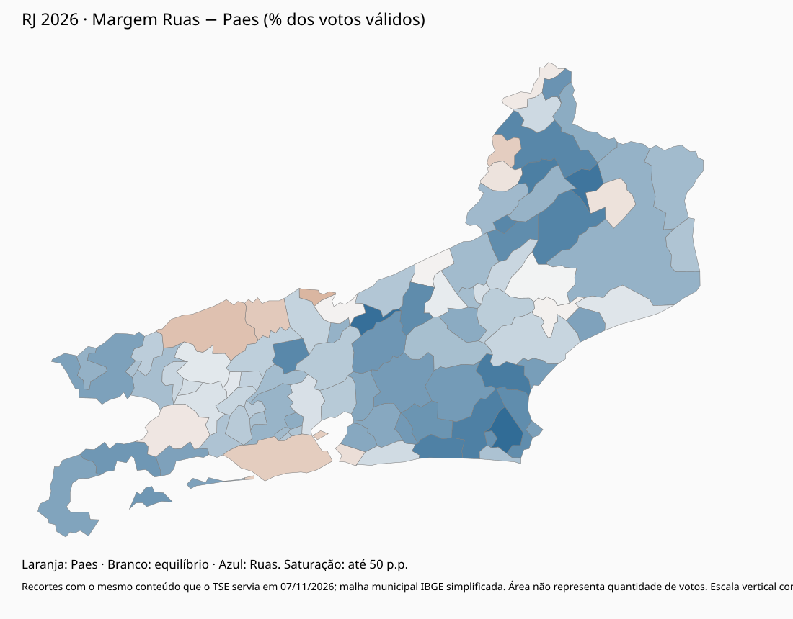

# Estudo eleitoral do Rio de Janeiro — 2026

Investigação independente e apartidária. Fontes consultadas até **7 de novembro de 2026**. Projeto separado de `analise-eleitoral-2026`. Repositório privado autorizado pelo usuário para auditoria; nenhuma publicação pública.

**A expectativa de vitória de Eduardo Paes tinha respaldo nas pesquisas, mas subestimou o resultado de Douglas Ruas. Paes venceu na capital e perdeu a disputa estadual porque sua vantagem carioca foi mais que compensada fora dela. A vitória de Ruas já no primeiro turno teve uma causa adicional e distinta: a anulação dos votos de Anthony Garotinho reduziu o total de votos válidos. Nenhum desses votos foi acrescentado a Ruas.**

Paes abriu **410.961 votos** na capital; Ruas abriu **975.176 fora dela**, vencendo por **564.215 votos** no estado. Ruas recebeu **4.271.199 votos** e Paes, **3.706.984**. A reconstrução contábil — os mesmos votos de Ruas sobre os válidos mais os 274.411 de Anthony — dá **49,27%**; depois da retotalização, **50,88%**. Nenhum voto mudou de candidato. O percentual anterior não foi lido numa totalização oficial prévia. [Cálculos](results/resumo.json) · [notícia do TRE-RJ](https://www.tre-rj.jus.br/comunicacao/noticias/2026/Outubro/retotalizacao-de-votos-aponta-douglas-ruas-como-vencedor-no-primeiro-turno-para-o-governo-do-rj), cuja página não ficou arquivada: o download direto deu 403.

**A impressão de que Ruas era pouco conhecido não significa que ele não tivesse base.** Em 2022 recebeu 175.977 votos para deputado, 149.576 em São Gonçalo. Isso é inserção anterior documentada. A candidatura também teve apoio registrado de Flávio Bolsonaro, Castro e Altineu, e uma identificação partidária disponível ao eleitor: associação e viabilização, não uma contribuição eleitoral medida. A amplitude de 2026 excedeu muito São Gonçalo: venceu em 79 dos 92 municípios. A expansão territorial é o resultado a explicar, não uma causa já separada. [Análise e fontes](ANALISE-DETALHADA.md).

**Garotinho, aqui, é Anthony Garotinho, candidato a governador pelo Republicanos.** Wladimir Garotinho, seu filho e candidato a deputado federal pelo PL, é outro ator: declarou apoio a Ruas depois da votação, dizendo ter apoiado o pai no primeiro turno. Não ocorreu segundo turno para governador no recorte observado. Portanto, o endosso posterior não demonstra transferência realizada. O efeito jurídico dos 274.411 votos anulados é comprovado; uma operação de transferência política não é. [Cronologia](research/CRONOLOGIA.md).

| Explicação | Classificação | O que a sustenta e o que falta |
|---|---|---|
| A vantagem fora da capital superou a de Paes na capital | **Estabelecida** | Recortes TSE reconciliados por município, zona e seção. A auditoria de 7/11 comparou o conteúdo ao canal do TSE naquele dia |
| A exclusão de Garotinho encerrou a disputa no primeiro turno | **Estabelecida no resultado proclamado** | Votação inalterada, denominador menor; há contestação judicial, sem trânsito em julgado demonstrado neste estudo |
| Ruas cresceu durante a campanha | **Apoiada por pesquisas** | Cinco séries separadas. Datafolha 19% → 34% até 2–3/10; Paraná 15,5% → 30,1%. Na Atlas, 31 ago e 20 set são rótulos de gráfico, sem ficha de campo; a figura espaça as ondas por igual, não por dia. Paes segue à frente nas últimas ondas com data de campo. A ultrapassagem não é datável |
| Inserção prévia de Ruas | **Estabelecida** | 175.977 votos em 2022, 149.576 em São Gonçalo, trajetória e rede familiar documentadas |
| Associação nacional e viabilização da candidatura | **Apoiadas** | Apoios de Flávio, Castro e Altineu; comparação presidencial em duas bases. Não mede quantos votos cada liderança produziu |
| Contribuição eleitoral de partido, líder, redes ou mensagens | **Não identificada** | Os testes afastam versões exclusivas. Não afastam contribuição parcial |
| Popularidade municipal garantia vitória estadual | **Refutada como garantia** | Paes manteve força carioca, insuficiente para o conjunto do estado |
| Prefeitos, igrejas, propaganda ou um debate explicam uma quantidade determinada de votos | **Ainda não demonstrada** | Há peças e publicidade descritas; faltam exposição, painel e identificação. Endosso não equivale a entrega |
| Garotinho transferiu seus votos para Ruas | **Ainda não demonstrada** | Anulação não é transferência; apoio de Wladimir é posterior; intenção hipotética de segundo turno não é voto observado |
| Houve uma virada de última hora claramente datada | **Ainda não demonstrada** | Nenhuma onda do corpus mostra Ruas à frente. Os dados não separam mudança tardia, erro comum de medição e comparecimento |

A descrição mais segura separa quatro coisas: inserção prévia de Ruas, associação e viabilização nacionais documentadas, limite territorial da vantagem de Paes e decisão jurídica que dispensou nova votação. A contribuição eleitoral de cada mecanismo não foi identificada. O peso de campanha, rejeição, religião, serviços ou redes sociais permanece indeterminado. As pesquisas não autorizavam certeza de vitória de Paes; o resultado tampouco autoriza declarar que sua liderança anterior nunca existiu. Refutar uma causa exclusiva não refuta uma contribuição parcial.

- [Análise detalhada](ANALISE-DETALHADA.md): pesquisas, mecanismos, regiões, história, participação e contraexemplos.
- [Tabelas](results/TABELAS.md), [municípios](results/municipios.csv), [zonas](results/zonas.csv), [seções](results/secoes.csv).
- [Fontes e divergências](research/FONTES.md), [hipóteses](research/HIPOTESES.md), [lacunas](research/LACUNAS.md).
- [Reprodução](REPRODUCAO.md) e [auditoria](AUDITORIA.md).

## Revisão independente

[Prompt completo para o Grok Bot](review-instructions/PROMPT-GROK.md) · [Como conectar e usar](review-instructions/COMO-USAR.md) · [Briefing original](review-instructions/BRIEFING-ORIGINAL.md). O ZIP bruto de seções é um asset da release privada `dados-v1`; restaure-o antes de reproduzir em um clone novo.
